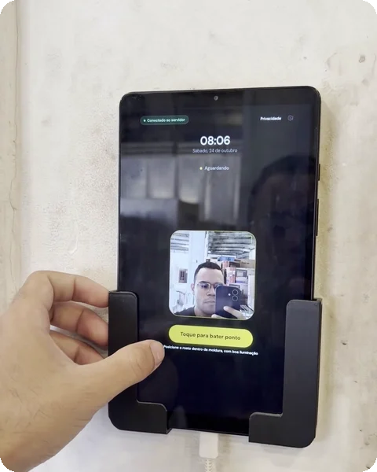
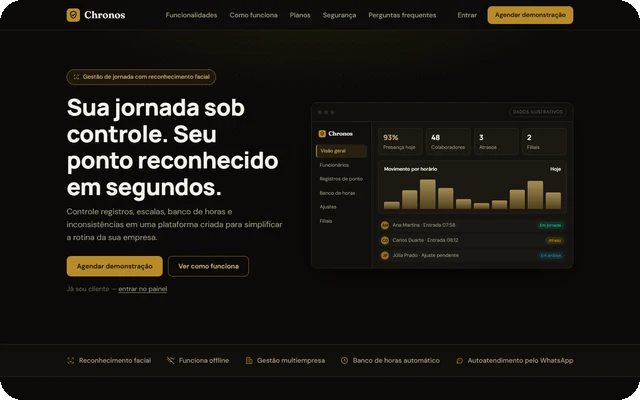
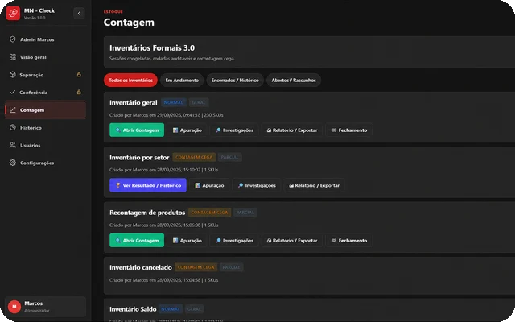
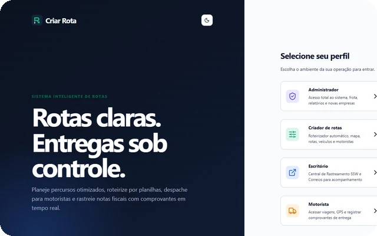

  

  
  
  
  

 

## Oi, eu sou o Marcos.

Estudo **Ciência da Computação na UNIFACISA** e escrevo software que roda em operação de verdade: ponto eletrônico, conferência de carga e roteirização de entregas.

Meu forte é o **back-end** (Python com Django, Java com Spring Boot), mas entrego o produto inteiro: banco, API e a tela que quem opera usa.

**Agora:** procuro minha primeira vaga de dev júnior ou estágio em back-end.

Na foto: eu testando o ponto por reconhecimento facial no tablet do Chronos.

 

 

## Projetos

<table>
  <tr>
    <td width="33%" valign="top">
      
      <h3>Chronos</h3>
      
Ponto por reconhecimento facial, banco de horas, folha com INSS e IRRF e arquivo AFD da Portaria 671. Multiempresa e funciona offline no tablet. <b>Em produção.</b>

      
<code>Django</code> · <code>React</code> · <code>PostgreSQL</code> · <code>Celery</code>

      
<a href="https://github.com/Neto-Marcos/chronos-showcase"><b>Vitrine técnica ↗</b></a> <a href="https://chronos-site-tau.vercel.app/">Site do produto ↗</a>

    </td>
    <td width="33%" valign="top">
      
      <h3>MN Check</h3>
      
Conferência de carga com coletor de código de barras, contagem de inventário e histórico de divergências. <b>Em produção</b> numa operação de estoque.

      
<code>Java 21</code> · <code>Spring Boot</code> · <code>PostgreSQL</code>

      
<a href="https://github.com/Neto-Marcos/mn-check"><b>Código ↗</b></a> <a href="https://check.criarrota.com.br/">Abrir aplicação ↗</a>

    </td>
    <td width="33%" valign="top">
      
      <h3>Criar Rota</h3>
      
Importa os pedidos da planilha, confere o estoque e sugere a carga e a rota por cidade, peso e cubagem. Acompanhamento no mapa.

      
<code>Next.js</code> · <code>TypeScript</code> · <code>PostgreSQL</code> · <code>Leaflet</code>

      
<a href="https://github.com/Neto-Marcos/Route_Wise"><b>Código ↗</b></a> <a href="https://criarrota.com.br">Conhecer o sistema ↗</a>

    </td>
  </tr>
</table>

Também: <a href="https://github.com/Neto-Marcos/contagem-app">Contagem App</a> — PWA offline para contagem de estoque (React, Node.js e PostgreSQL).

 

## Stack

  
  
  
  
  
  
  
  
  
  
  
  
  

 

## Atividade · atualizada todo dia

  <picture>
    <source media="(prefers-color-scheme: dark)" srcset="https://raw.githubusercontent.com/Neto-Marcos/Neto-Marcos/output/snake-dark.svg" />
    <source media="(prefers-color-scheme: light)" srcset="https://raw.githubusercontent.com/Neto-Marcos/Neto-Marcos/output/snake.svg" />
    
  </picture>

 

  Back-end primeiro, produto completo. · <a href="https://portfolio-marcos-neto.vercel.app">portfolio-marcos-neto.vercel.app</a>

