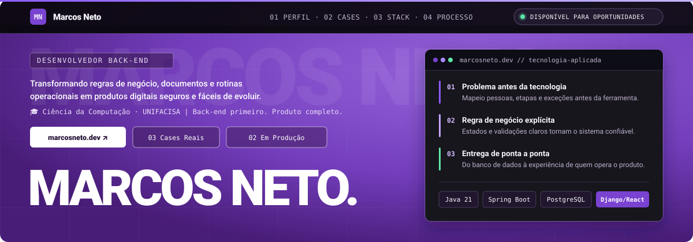

<p align="center">
  <a href="https://portfolio-marcos-neto.vercel.app">
    
  </a>
</p>

<p align="center">
  <a href="https://portfolio-marcos-neto.vercel.app"></a>
  <a href="https://criarrota.com.br"></a>
  <a href="https://check.criarrota.com.br/"></a>
  <a href="https://chronos-site-tau.vercel.app/"></a>
  <a href="https://www.linkedin.com/in/marcos-neto-bbab573b6/"></a>
</p>

---

## `01` // Perfil — *Back-end primeiro. Produto completo.*

Minha especialidade é transformar **regras de negócio, documentos e rotinas operacionais** em fluxos digitais seguros e fáceis de evoluir. Atualmente curso **Ciência da Computação na UNIFACISA** e concentro meus estudos em **Java, Spring Boot, APIs REST, bancos de dados, automação e aplicações web para logística e gestão**.

```text
FORMAÇÃO       ▶ Ciência da Computação · UNIFACISA (Graduação em andamento)
OBJETIVO       ▶ Estágio ou posição júnior em desenvolvimento Back-end
DISPONÍVEL     ▶ Projetos de APIs, automações operacionais e sistemas web

01  PROBLEMA ANTES DA TECNOLOGIA   ▶ Mapeio pessoas, etapas e exceções antes de escolher ferramentas.
02  REGRA DE NEGÓCIO EXPLÍCITA     ▶ Estados e validações claros tornam o sistema mais confiável.
03  ENTREGA DE PONTA A PONTA       ▶ Do banco de dados à experiência de quem opera o produto.
```

---

## `02` // Cases selecionados — *O que eu construí.*

Conheça os sistemas em produção, as demonstrações e as decisões técnicas tomadas em cada projeto:

<table>
  <tr>
    <td width="58%">
      <kbd>01 / DESTAQUE</kbd> &nbsp; <kbd>PLANEJAMENTO DE ENTREGAS</kbd> &nbsp; <kbd>WEB / PWA</kbd>
      <h3>Criar Rota (RouteWise TMS)</h3>
      <p>Da carteira de pedidos ao retorno do caminhão: importação de planilhas, verificação de disponibilidade, sugestões de cargas e rotas por cidades, peso e cubagem, sequência de carregamento LIFO e acompanhamento em tempo real.</p>
      <p><strong>Stack:</strong> <code>Next.js</code> · <code>React</code> · <code>TypeScript</code> · <code>PostgreSQL</code> · <code>Leaflet</code> · <code>PWA</code></p>
      <p>
        <a href="https://criarrota.com.br"><strong>Conhecer o sistema ↗</strong></a> &nbsp;·&nbsp;
        <a href="https://github.com/Neto-Marcos/Route_Wise">Ver código no GitHub ↗</a>
      </p>
    </td>
    <td width="42%" align="center">
      <a href="https://github.com/Neto-Marcos/Route_Wise">
        
      </a>
    </td>
  </tr>
</table>

<table>
  <tr>
    <td width="58%">
      <kbd>02 / LOGÍSTICA</kbd> &nbsp; <kbd>EM PRODUÇÃO</kbd> &nbsp; <kbd>v3.0.0</kbd>
      <h3>MN Check</h3>
      <p>Sistema para mapas de carga, separação por coletor, conferência de expedição e contagem de estoque (com apuração, recontagem e investigação cega de divergências) em um fluxo logístico real.</p>
      <p><strong>Arquitetura:</strong> <code>Coletor / Web</code> → <code>Spring Boot API</code> → <code>PostgreSQL</code></p>
      <p><strong>Stack:</strong> <code>Java 21</code> · <code>Spring Boot</code> · <code>PostgreSQL</code> · <code>Flyway</code> · <code>PDFBox</code> · <code>React</code> · <code>Docker</code></p>
      <p>
        <a href="https://check.criarrota.com.br/"><strong>Abrir aplicação ↗</strong></a> &nbsp;·&nbsp;
        <a href="https://github.com/Neto-Marcos/mn-check">Ver código no GitHub ↗</a>
      </p>
    </td>
    <td width="42%" align="center">
      <a href="https://github.com/Neto-Marcos/mn-check">
        
      </a>
    </td>
  </tr>
</table>

<table>
  <tr>
    <td width="58%">
      <kbd>03 / SAAS</kbd> &nbsp; <kbd>EM PRODUÇÃO</kbd> &nbsp; <kbd>MULTIEMPRESA</kbd>
      <h3>Chronos — Gestão de Jornada</h3>
      <p>Ecossistema de gestão de jornada com painel administrativo, registro de ponto por reconhecimento facial, banco de horas e operação offline-first em tablets com sincronização posterior. Multiempresa com isolamento por tenant, geração do AFD da Portaria 671 do MTE, folha com INSS e IRRF, integração com WhatsApp, deploy com Docker e CI, e mais de 500 testes automatizados.</p>
      <p><strong>Arquitetura:</strong> <code>PWAs / React</code> → <code>Django REST</code> → <code>PostgreSQL</code></p>
      <p><strong>Stack:</strong> <code>Django REST</code> · <code>Python</code> · <code>Celery</code> · <code>Redis</code> · <code>React</code> · <code>TypeScript</code> · <code>PWA</code> · <code>PostgreSQL</code> · <code>Docker</code></p>
      <p>
        <a href="https://chronos-site-tau.vercel.app/"><strong>Conhecer o produto ↗</strong></a> &nbsp;·&nbsp;
        <a href="https://chronos.criarrota.com.br/"><strong>Abrir painel ↗</strong></a> &nbsp;·&nbsp;
        <a href="https://github.com/Neto-Marcos/chronos-showcase">Vitrine técnica ↗</a> &nbsp;·&nbsp;
        <a href="https://github.com/Neto-Marcos/chronos-landing-page">Landing page ↗</a>
      </p>
    </td>
    <td width="42%" align="center">
      <a href="https://github.com/Neto-Marcos/chronos-landing-page">
        
      </a>
    </td>
  </tr>
</table>

<table>
  <tr>
    <td width="58%">
      <kbd>04 / PWA</kbd> &nbsp; <kbd>OFFLINE-FIRST</kbd> &nbsp; <kbd>CONTAGEM DE ESTOQUE</kbd>
      <h3>Contagem App</h3>
      <p>Aplicativo PWA instalável e API REST para contagem física de estoque por filial e período, importação automática de saldos via PDF/Excel/CSV e cálculo automático de divergências.</p>
      <p><strong>Stack:</strong> <code>React</code> · <code>Node.js</code> · <code>PostgreSQL</code> · <code>IndexedDB</code> · <code>Vite</code></p>
      <p>
        <a href="https://github.com/Neto-Marcos/contagem-app"><strong>Ver código no GitHub ↗</strong></a>
      </p>
    </td>
    <td width="42%" align="center">
      <a href="https://github.com/Neto-Marcos/contagem-app">
        
      </a>
    </td>
  </tr>
</table>

---

## `03` // Stack com propósito — *Ferramentas ligadas ao que eu entrego.*

Mais do que listar tecnologias, estas são as responsabilidades que assumo ao construir um produto:

<table>
  <tr>
    <td width="25%" valign="top">
      <sub><code>01</code></sub>
      <h4>Regras e APIs</h4>
      <p><sub>Serviços, autenticação, validações e integrações orientadas à operação.</sub></p>
      <br/>
      <br/>
      <br/>
      <br/>
      
    </td>
    <td width="25%" valign="top">
      <sub><code>02</code></sub>
      <h4>Dados rastreáveis</h4>
      <p><sub>Modelagem, persistência, histórico e isolamento seguro por contexto.</sub></p>
      <br/>
      <br/>
      <br/>
      <br/>
      
    </td>
    <td width="25%" valign="top">
      <sub><code>03</code></sub>
      <h4>Interfaces de produto</h4>
      <p><sub>Experiências responsivas para desktop, tablet e operação móvel.</sub></p>
      <br/>
      <br/>
      <br/>
      <br/>
      
    </td>
    <td width="25%" valign="top">
      <sub><code>04</code></sub>
      <h4>Entrega e automação</h4>
      <p><sub>Documentos, containers, versionamento e publicação contínua.</sub></p>
      <br/>
      <br/>
      <br/>
      <br/>
      
    </td>
  </tr>
</table>

---

## `04` // Processo — *Do problema ao sistema.*

| Etapa | Foco | Descrição |
| :---: | :--- | :--- |
| **`01`** | **Entender a operação** | Pessoas, etapas, exceções e resultado esperado. |
| **`02`** | **Modelar regras e dados** | Entidades, estados, permissões e validações. |
| **`03`** | **Construir o fluxo completo** | Back-end, dados e interface funcionando como produto. |
| **`04`** | **Validar e evoluir** | Casos reais, testes proporcionais ao risco e ciclos curtos. |

---

## `05` // Métricas e atividade

<p align="center">
  
  
</p>

<p align="center">
  
</p>

---

## `06` // Contato — *Vamos construir algo útil de verdade.*

Se existe uma operação para organizar, uma API para estruturar ou um produto para tirar do papel, vamos conversar:

<p align="center">
  <a href="https://portfolio-marcos-neto.vercel.app"></a>
  <a href="https://wa.me/5583991744139?text=Ol%C3%A1%2C%20Marcos!%20Vi%20seu%20GitHub%20e%20quero%20conversar."></a>
  <a href="https://www.linkedin.com/in/marcos-neto-bbab573b6/"></a>
  <a href="mailto:marcos.neto0706@gmail.com"></a>
</p>
